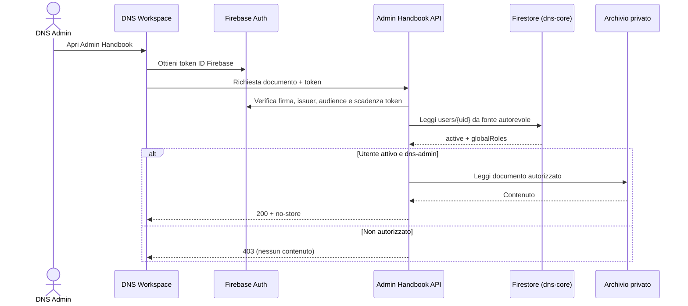

# DNS Admin Handbook — integrazione con Identity esistente

Data ricognizione: 2026-11-10. **Specifiche e controlli da implementare; non dichiarare operativo.**

## Riferimenti verificati nel codice

- `dns-workspace/src/services/dnsIdentity.ts`: autenticazione Firebase con Google Sign-in e fallback email/password; profilo in `users/{uid}`, membership in `memberships`, grant in `accessGrants`; ruolo amministrativo identificato da `profile.globalRoles.includes('dns-admin')`.
- `dns-workspace/src/workspace/access.ts`: `toolsForOrganization` e `adminAreaTools` governano **solo la visibilità dell'interfaccia**. Il commento del codice richiede che ogni tool/API applichi autorizzazioni indipendenti.
- `dns-workspace/server/index.mjs`: Cloud Function callable `dnsWorkspaceAccess` in `europe-west8`, Firebase Admin SDK, handler `accessService`; il codice precisa che il deploy è una decisione separata.
- `dns-shared-data/.firebaserc`: progetto predefinito configurato `dns-core`; la configurazione non equivale a conferma dello stato cloud.

## Disegno di integrazione proposto

## Contratto API preliminare

- `GET /admin-handbook/index`: restituisce solo un indice di documenti autorizzati.
- `GET /admin-handbook/documents/:id`: restituisce un documento, senza accettare percorsi arbitrari.
- `GET /admin-handbook/attachments/:id`: accesso ad allegati con stesso controllo.
- Tutti gli endpoint: `Authorization: Bearer <Firebase ID token>`, validazione server-side tramite Firebase Admin SDK, lettura del documento `users/{uid}`, controllo `active === true` e `globalRoles` contenente `dns-admin`.
- La semplice presenza di `dns-admin` nel client non autorizza mai il backend. L'API deve verificare il progetto Firebase e rifiutare token di altri ambienti.
- `Cache-Control: private, no-store`, `X-Content-Type-Options: nosniff`; logging di uid/azione/esito senza testo dei documenti né token.
- Document ID normalizzati da manifest autorizzato, mai filesystem path controllati dal client; sanificazione dell'output Markdown/HTML.
- Rifiutare accesso non autenticato (401) e autenticato non admin (403); nessun fallback a contenuti statici pubblici.
- Il repository sorgente deve essere **privato** e il backend deve usare credenziali di sola lettura, con permessi minimi e rotazione; non esporre GitHub token nel frontend.
- Valutare ulteriori policy su MFA, re-auth e audit prima di esporre documentazione amministrativa sensibile.

## Fasi operative

1. Creare `dolomitinordicski/dns-admin-handbook` come repository **private**, senza GitHub Pages e senza fork pubblici.
2. Inserire in quel repository le schede amministrative, non in `dns-wiki`.
3. Implementare API privata e test autorizzativi nel repository backend appropriato; verificare progetto Firebase, IAM e service account reali.
4. Collegare in DNS Workspace un pannello visibile solo a `dns-admin`, che consumi esclusivamente l'API privata.
5. Aggiungere nella Wiki pubblica al massimo una descrizione generica e un collegamento al Workspace, senza URL di documenti privati.
6. Collaudare con DNS Admin, area, AT, anonimo, accesso diretto, revoca ruolo e build statica.
7. Richiedere approvazione esplicita per merge/deploy, IAM, rules e modifiche di produzione.

## Blocco operativo attuale

Il connettore GitHub disponibile consente lettura e modifica di file/branch/PR, ma **non espone un'azione per creare repository**. Non creare l'archivio admin nel repository pubblico come ripiego. La creazione del repository privato è un prerequisito non ancora soddisfatto.

## Accettazione

La funzionalità si considera completa **solo** se il contenuto riservato non compare negli artifact Pages, non è raggiungibile senza autorizzazione server-side e tutti i test di isolamento risultano verdi.
